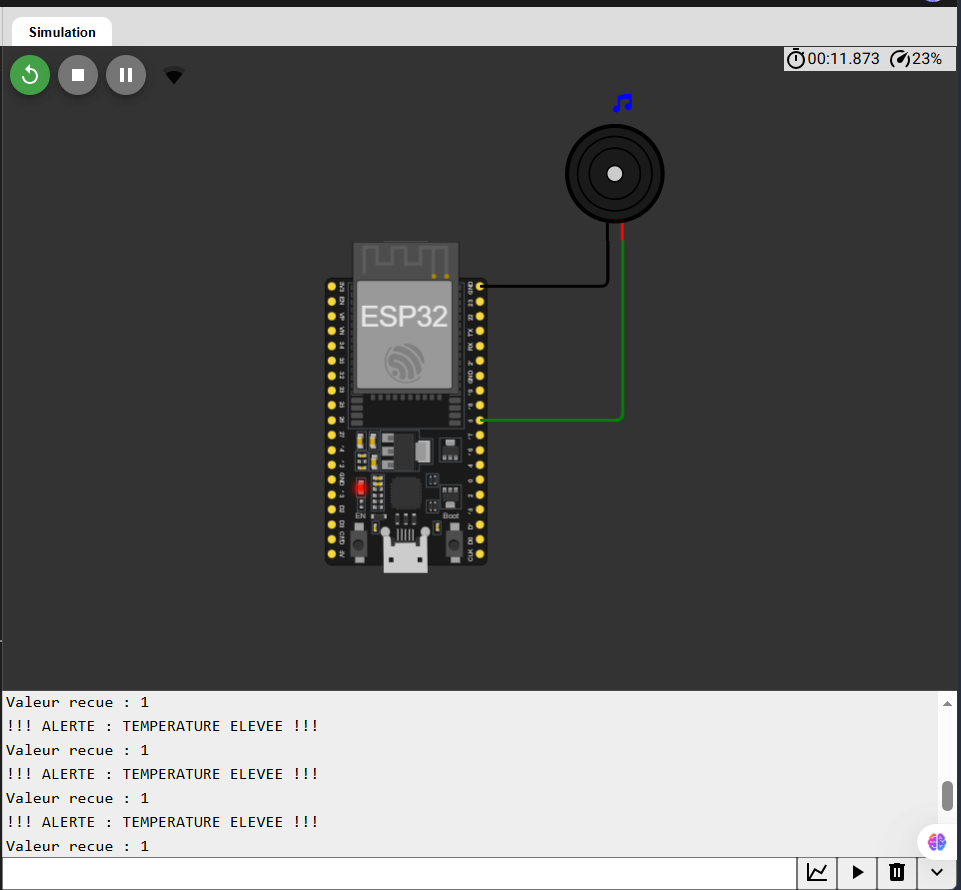

# Scénario 1 — Alerte de proximité par MQTT

Deux cartes ESP32 communiquent par MQTT : le Publisher mesure la distance avec un capteur ultrasonique HC-SR04 et le Subscriber actionne un buzzer lorsqu'un obstacle se trouve à moins de 100 cm. Le Subscriber affiche également l'état de l'alerte sur le port série.

## Matériel et câblage

Deux ESP32, un HC-SR04 raccordé au Publisher et un buzzer raccordé au Subscriber.

| Carte | Composant | Broche ESP32 |
|---|---|---|
| Publisher | HC-SR04 TRIG | GPIO 5 |
| Publisher | HC-SR04 ECHO | GPIO 18 |
| Subscriber | Buzzer | GPIO 23 |

Relier l'alimentation et la masse des composants selon les schémas Wokwi. Pour un montage réel, adapter le niveau de la sortie ECHO du HC-SR04 à l'entrée 3,3 V de l'ESP32.

## Fonctionnement

1. Le Publisher mesure périodiquement la distance et publie sa valeur en centimètres sur `serre/fedi/obstacle/2026` si elle est inférieure à 100 cm.
2. Le Subscriber compare la valeur reçue au seuil, affiche une alerte série et active le buzzer.
3. Lorsque l'obstacle s'éloigne, le Publisher envoie `CLEAR` et le Subscriber arrête le buzzer.

Les deux sketches utilisent le Wi-Fi `Wokwi-GUEST` et le broker MQTT public `broker.hivemq.com:1883`. Garder le même topic sur les deux cartes ; choisir un topic propre à votre installation pour éviter les messages partagés sur le broker public.

## Archives et captures

- [Télécharger le Publisher](Publisher.zip) — bibliothèque `PubSubClient`.
- [Télécharger le Subscriber](Subscriber.zip) — bibliothèque `PubSubClient`.
- [Ouvrir le Publisher dans Wokwi](https://wokwi.com/projects/481114382676958209).
- [Ouvrir le Subscriber dans Wokwi](https://wokwi.com/projects/481114419398098945).

### Publisher — HC-SR04

### Subscriber — buzzer

Pour simuler, ouvrir les deux projets Wokwi, lancer chaque ESP32 et vérifier que les deux sketches utilisent le même topic MQTT.
