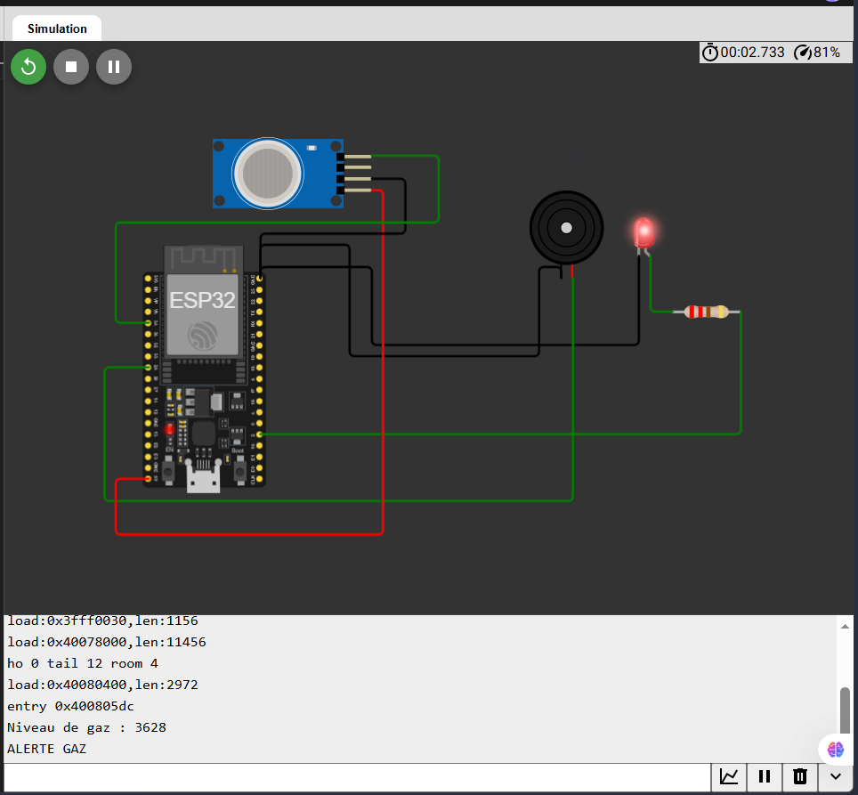

# Projets IoT — ESP32 et Wokwi

Ce dépôt rassemble des projets pratiques autour de l’Internet des objets (IoT), réalisés avec des microcontrôleurs ESP32 et des composants électroniques. Chaque branche contient un projet indépendant avec son code, son schéma de câblage Wokwi et une image de présentation.

## Projets

- [Connexion à un point d’accès Wi-Fi](https://github.com/Bejaoui-Fedi/Middleware-for-internet-of-things/tree/connexion-point-acces)
- [Détection de fuite de gaz](https://github.com/Bejaoui-Fedi/Middleware-for-internet-of-things/tree/detection-fuite-gaz)
- [Station météo](https://github.com/Bejaoui-Fedi/Middleware-for-internet-of-things/tree/station-meteo)
- [Système d’éclairage automatique](https://github.com/Bejaoui-Fedi/Middleware-for-internet-of-things/tree/systeme-eclairage)
- [Détection d’incendie](https://github.com/Bejaoui-Fedi/Middleware-for-internet-of-things/tree/systeme-detection-incendie)
- [Variation de l’angle d’un servomoteur](https://github.com/Bejaoui-Fedi/Middleware-for-internet-of-things/tree/variation-angle-servomoteur)

## Connexion à un point d’accès Wi-Fi

Ce projet ESP32 se connecte au réseau Wi-Fi Wokwi-GUEST et affiche dans le moniteur série l’état de la connexion ainsi que l’adresse IP obtenue.

### Aperçu du projet

