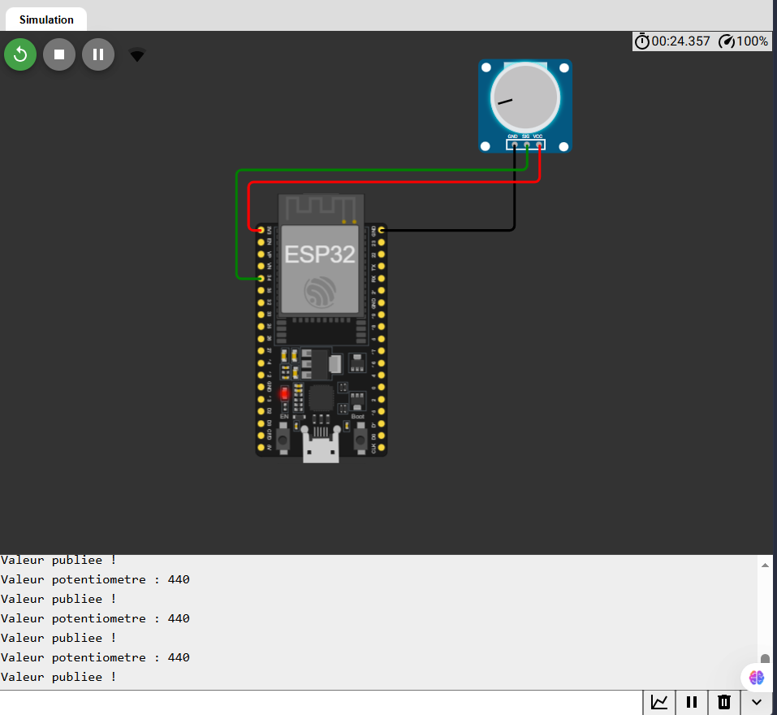

# Scénario 2 — Alerte de température par MQTT

Deux cartes ESP32 communiquent par MQTT. Le Publisher mesure la température avec un DHT11 et envoie `1` lorsque la température dépasse 30 °C ; sinon, il envoie `0`. Le Subscriber reçoit cet état, affiche le résultat sur le port série et commande un buzzer.

## Matériel et câblage

Deux ESP32, un capteur DHT11 raccordé au Publisher et un buzzer raccordé au Subscriber.

| Carte | Composant | Broche ESP32 |
|---|---|---|
| Publisher | DHT11 DATA | GPIO 4 |
| Subscriber | Buzzer | GPIO 5 |

Relier l'alimentation et la masse des composants selon les schémas fournis dans les archives.

## Fonctionnement

1. Le Publisher lit la température toutes les deux secondes.
2. Il publie `1` si la température est supérieure à 30 °C, et `0` sinon, sur `fedi/scenario2/alerte`.
3. Le Subscriber active le buzzer et affiche une alerte si la valeur reçue est `1`. Pour `0`, il arrête le buzzer et signale que la température est normale.

Les deux sketches utilisent le Wi-Fi `Wokwi-GUEST` et le broker MQTT public `broker.hivemq.com:1883`. Garder le même topic sur les deux cartes ; choisir un topic propre à votre installation pour éviter les messages partagés sur le broker public.

## Archives et captures

- [Télécharger le Publisher](Publisher.zip) — bibliothèques `PubSubClient` et `DHT sensor library`.
- [Télécharger le Subscriber](Subscriber.zip) — bibliothèque `PubSubClient`.

Les archives utilisent bien un **DHT11**. La capture du Publisher ci-dessous provient du projet d'origine et montre un **DHT22** ; elle est conservée comme aperçu du montage, pas comme preuve du modèle de capteur de l'archive.

### Publisher — aperçu du montage du capteur

### Subscriber — buzzer

Pour simuler la version DHT11, importer les fichiers de chaque archive dans deux projets Wokwi distincts, lancer les deux ESP32 et vérifier que les sketches utilisent le même topic MQTT.
