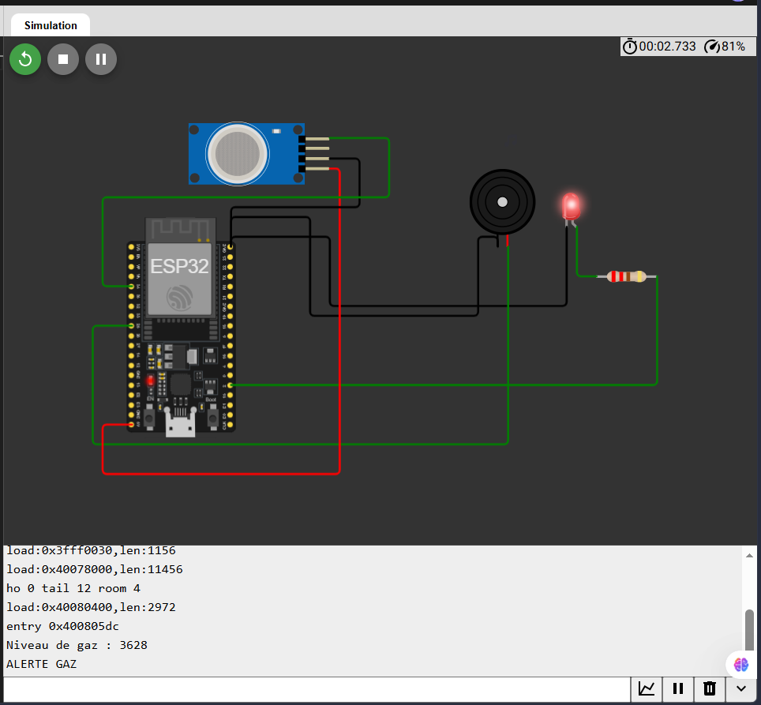

# Connexion à un point d’accès Wi-Fi

Ce projet présente la connexion d’une carte ESP32 à un réseau Wi-Fi avec Wokwi. Une fois connectée au réseau de simulation `Wokwi-GUEST`, la carte affiche l’état de la connexion ainsi que l’adresse IP obtenue dans le moniteur série.

## Matériel et configuration

- Une carte ESP32.
- Un accès Wi-Fi. Pour la simulation Wokwi, utiliser le SSID `Wokwi-GUEST` sans mot de passe.

## Fonctionnement

Au démarrage, le programme lance la connexion au réseau Wi-Fi, attend qu’elle soit établie, puis affiche son résultat et l’adresse IP dans le moniteur série à 115200 bauds.

## Fichiers du projet

- [`sketch.ino`](sketch.ino) — code de connexion Wi-Fi.
- [`diagram.json`](diagram.json) — schéma de simulation Wokwi.

## Aperçu du projet

